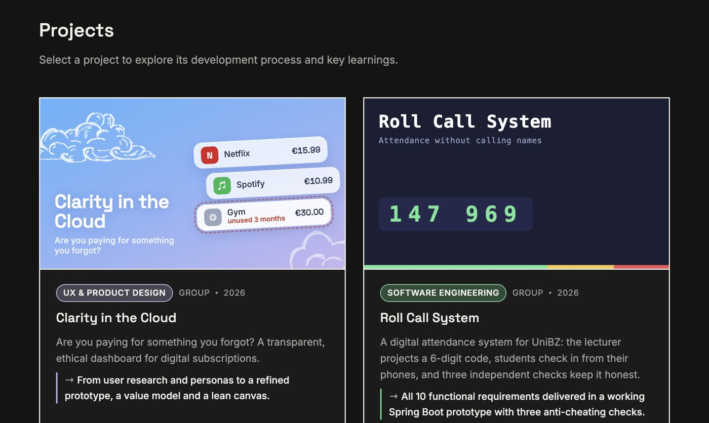

# Chiara Maddalena Luongo — Portfolio

Business Informatics student at the Free University of Bozen-Bolzano. This repository holds my personal portfolio: university and personal projects, each documented step by step with its own visual theme.

**🌐 Live site: [chiaral24.github.io](https://chiaral24.github.io)** · [LinkedIn](https://www.linkedin.com/in/chiara-maddalena-luongo) · [Download CV](https://chiaral24.github.io/assets/cv/Chiara-Maddalena-Luongo-CV.pdf)

[](https://chiaral24.github.io/#/projects)

## Projects

| Project | Area | Type | Year |
|---|---|---|---|
| [Clarity in the Cloud](https://chiaral24.github.io/#/projects/clarity-in-the-cloud) | UX & Product Design | Group | 2026 |
| [Roll Call System](https://chiaral24.github.io/#/projects/roll-call-system) | Software Engineering | Group | 2026 |
| [Catch ‘n’ Trade](https://chiaral24.github.io/#/projects/catch-n-trade) | Databases & Development | Group | 2025 |
| [Just read a book](https://chiaral24.github.io/#/projects/just-read-a-book) | Data Mining | Individual | 2026 |
| [Wine, Satellites & the God Particle](https://chiaral24.github.io/#/projects/wine-satellites-god-particle) | Data Mining | Individual | 2026 |
| [Universal Pictures: Enterprise Architecture](https://chiaral24.github.io/#/projects/universal-enterprise-architecture) | Enterprise Architecture | Group | 2025 |
| [Ethical and Legal Challenges of AI in Mental Health](https://chiaral24.github.io/#/projects/ai-mental-health-ethics) | Research · AI Ethics & Law | Group seminar paper | 2026 |
| [Inspora](https://chiaral24.github.io/#/projects/inspora) | Project Management & Product | Group | 2026 |
| [The Traveler Notebook](https://chiaral24.github.io/#/projects/traveler-notebook) | Web Development | Group | 2024 |
| [GreatEat](https://chiaral24.github.io/#/projects/greateat) | Mobile Development | Individual | 2024 |
| [Can Taco Bell Make a Splash in Italy?](https://chiaral24.github.io/#/projects/taco-bell-italy) | Corporate Finance | Individual | 2024 |
| [Pixel Library](https://chiaral24.github.io/#/projects/pixel-library) | App Development | Personal | 2026 |

## Built with

- **Plain HTML, CSS and JavaScript** — no framework and no build step. A small hash router (`app.js`) renders every page from the data in `content.js`.
- **Custom blocks** for the documentation pages: charts with tooltips and data tables, schemas, timelines, code excerpts, phone and browser frames, slide carousels.
- **Light and dark themes**, a personalised theme for each project, entrance animations that respect `prefers-reduced-motion`, and a layout that works on phones.
- **Hosted on GitHub Pages.**

## Security and privacy

- A **Content Security Policy** allows scripts, styles, images and fonts only from this site and blocks connections to other servers.
- All text is **escaped** before it reaches the page; the address bar is only compared with known project names, never inserted into the page.
- **Fonts are self-hosted**, so visitors' browsers make no requests to third parties.
- No cookies, no trackers, no forms, no API keys.

## Run locally

```bash
git clone https://github.com/chiaral24/chiaral24.github.io.git
cd chiaral24.github.io
python3 -m http.server 8090
```

Then open <http://localhost:8090>. Any static file server works, since there is nothing to install or build.

## Project structure

```
index.html          page shell, Content Security Policy, fonts
content.js          profile and projects: all texts and data
app.js              router and rendering of every block
style.css           base styles, light/dark themes, one theme per project
assets/             images, fonts, CV, theme script
```

To add a project, add an entry to `PROJECTS` in `content.js` and put its images in `assets/projects/<name>/`.

## Credits and reuse

- Fonts: [Inter](https://rsms.me/inter/), [Space Grotesk](https://fonts.google.com/specimen/Space+Grotesk) and [DM Serif Display](https://fonts.google.com/specimen/DM+Serif+Display), under the SIL Open Font License.
- Group projects were made together with the teammates named on each project page.
- You are welcome to look at the code for inspiration. The **texts, images, photo and CV are personal**: please do not republish them as your own.
